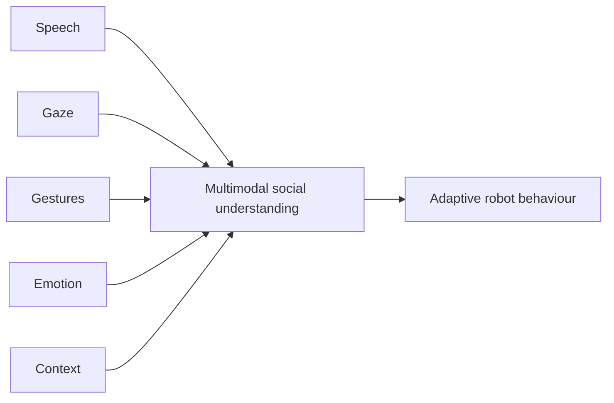

# NAVER LABS Europe — 3rd International HRI Symposium

*These are personal notes, supplemented with related publications and project resources. They are not official proceedings or a transcript.

| | |
| --- | --- |
| **Date** | 19 November 2026 |
| **Location** | Grenoble–Meylan, France |
| **Organizer** | NAVER LABS Europe |
| **Programme** | [Official symposium website](https://europe.naverlabs.com/updates/hri-international-symposium/#program) |
| **Participation** | Student poster presenter |
| **Topics** | Social robotics, multimodal conversational AI, human–AI alignment, real-world deployment |

## Overview

I attended the 3rd International Human–Robot Interaction (HRI) Symposium organized by NAVER LABS Europe and presented my master's thesis research on managing large language model (LLM) response delays in spoken human–robot interaction.

The symposium explored how robots can interact, collaborate, and coexist with humans in real-world environments. A recurring theme was the need to move beyond technical performance and consider the social, organizational, and temporal dimensions of human–robot interaction.

This README consolidates my symposium notes, related research publications, and personal reflections. Interpretations and potential research directions are my own, not necessarily claims made by the speakers.

## Table of contents

- [Morning session: Conversational HRI](#morning-session-conversational-hri)
  - [Mary Ellen Foster — Real-world robot deployment](#1-mary-ellen-foster--real-world-robot-deployment)
  - [Oya Celiktutan — Multimodal social intelligence](#2-oya-celiktutan--multimodal-social-intelligence)
  - [Damien Rudaz — Real-time AI and turn-taking](#3-damien-rudaz--real-time-ai-and-turn-taking)
  - [Emmanuel Senft — Human–AI knowledge alignment](#4-emmanuel-senft--humanai-knowledge-alignment)
- [Afternoon session: Navigation and shared spaces](#afternoon-session-navigation-and-shared-spaces)
- [Cross-cutting research themes](#cross-cutting-research-themes)
- [My research and future directions](#my-research-and-future-directions)
- [Implications for AI and robotics product development](#implications-for-ai-and-robotics-product-development)
- [Final reflection](#final-reflection)

## Morning session: Conversational HRI

### 1. Mary Ellen Foster — Real-world robot deployment

**Institution:** University of Glasgow  
**Talk:** When Robots Leave the Lab: Lessons from the Real World  
**Research areas:** Social robotics, long-term HRI, participatory design, conversational interfaces  
**Profile:** [Mary Ellen Foster](https://www.maryellenfoster.uk/)

#### Humans as social sense-makers

Humans actively interpret robot behaviour and construct meaning around their interactions. The role a robot eventually occupies may differ from its original design intention.

Robot customization is one example of this process. People may customize robots to express their identity, extend their sense of self, develop psychological ownership, or establish a personal relationship with the technology.

Living with a robot does not necessarily mean treating it as a companion. The same robot can occupy several roles:

- **Machine:** A functional tool.
- **Companion:** A source of social or emotional engagement.
- **Hobby:** Something enjoyable to explore.
- **Project:** Something to develop, customize, or improve.
- **Household presence:** Something integrated into everyday domestic life.

#### What remains when the robot leaves?

Longitudinal HRI should distinguish between novelty effects, habit formation, and sustained behavioural change. The WallBo handwashing robot illustrates this distinction: beyond whether children engage with the robot, an important question is whether improved handwashing habits persist after it is removed.

#### Zooming out: What constitutes successful HRI?

| Evaluation perspective | Central question |
| --- | --- |
| Robot + user | How well does the interaction work? |
| Robot + relationship | What does the interaction mean to people? |
| Robot + stakeholders | For whom does the system work? |
| Sociotechnical environment | How does the system fit into existing practices and institutions? |

Robots do not enter empty environments. They are introduced into existing sociotechnical systems containing routines, technologies, institutions, and competing interests.

Organizations tend to ask whether the robot solves a problem worth solving, fits existing workflows, creates value for stakeholders, distributes costs appropriately, and remains sustainable after the research project ends.

The **MuMMER (MultiModal Mall Entertainment Robot)** project, which explored social robotics in a Finnish shopping mall, provides a concrete example of the challenges of real-world deployment. These include changing goals, stakeholder conflicts, management changes, recruitment failures, and operational workarounds.

The *Failing Forward* research initiative also highlights the importance of learning from unsuccessful deployments and unexpected outcomes, rather than focusing exclusively on successful experiments.

> **Key takeaway:** Successful HRI is not just about a robot that people enjoy interacting with. It is about creating sustainable value within the environment in which the robot operates.

#### Related research

- [Crafting Companions: A Mixed Methods Exploration of Customization Amongst Robot Owners (2026)](https://eprints.gla.ac.uk/373359/)
- [Where Are They? The Absence of Social Robots in Real-World Environments (2026)](https://eprints.gla.ac.uk/377548/)
- [Failing Forward: Design and Deployment Lessons from Real-World Human-Robot Interaction (2026)](https://intelligent-earth.ox.ac.uk/publication/2391555/dimensions)
- [MuMMER Project](https://www.gla.ac.uk/external/mummer/about/)

### 2. Oya Celiktutan — Multimodal social intelligence

**Institution:** King's College London  
**Talk:** Human–Robot Non-Verbal Communication  
**Research areas:** Multimodal machine learning, gaze, affective computing, gesture generation, assistive robotics  
**Lab:** [Social AI & Robotics (SAIR) Lab](https://sairlab.github.io/) · [Research profile](https://oceliktutan.github.io/)

#### CO-STAR: Socially intelligent robots for healthcare

CO-STAR (CO-designing Socially inTelligent Assistive Robots for Future Healthcare) explores socially intelligent assistive robots designed with healthcare stakeholders.

The presentation discussed a hospital reception pilot and the Mirokaï robotic platform. Healthcare is a particularly challenging context because robots need to communicate with people with diverse abilities, needs, and emotional states while operating within clinical workflows.

#### Gaze communication understanding

Gaze is an important indicator of attention and conversational intention. Two related tasks are:

- **Gaze following:** Identifying what a person is looking at.
- **Gaze communication understanding:** Interpreting the social function of that gaze.

The presentation covered multitask gaze understanding using a CLIP-based end-to-end architecture, according to my notes. Learning related tasks jointly offers a route toward richer interpretations of gaze behaviour.

#### When gaze meets speech

Vision-only models may estimate where someone is looking without understanding the conversational context. Human gaze is coordinated with speech, so language can provide semantic information that visual data alone may not capture.

Language-guided training is one direction for integrating contextual knowledge into gaze models. Potential applications include joint attention, addressee detection, and turn-taking.

#### Emotion recognition: CAKE

**CAKE (Context-Aware Kid Emotion In-the-Wild)** is a dataset for context-aware recognition of children's emotions. My notes record the following elements:

- Twelve emotion categories alongside valence and arousal annotations.
- Contextual and semantic information.
- Caption-guided training and class prompts for inference.

Valence represents the positive or negative dimension of affect, while arousal represents its level of activation. Contextual emotion modelling could help assistive robots respond to possible confusion or frustration, although model predictions should not be treated as definitive readings of someone's internal state.

#### Co-speech gestures and multiparty turn-taking

Co-speech gesture generation aims to produce physical movements that are contextually appropriate and temporally coordinated with speech.

Multiparty conversation remains a major challenge. A conversational agent must determine who is speaking, who is being addressed, who may speak next, and when its own contribution is appropriate. This requires combining audio with nonverbal and contextual cues rather than relying on speech alone.

*Conceptual synthesis of the talk's research themes; not a specific model architecture.*

> **Key takeaway:** Conversation goes beyond speech. Inclusive conversational AI requires multimodal perception, temporal coordination, and more diverse data representing different users and communication styles.

#### Related research

- [CO-STAR Healthcare Robotics](https://raeng.org.uk/174090)
- [Multi-Task Gaze Communication Understanding (2025) — publication index](https://dblp.org/pid/05/4947.html)
- [CAKE: Context-Aware Kid Emotion In-the-Wild Dataset (2026)](https://doi.org/10.1109/FG67764.2026.11557063)
- [Gesticulating with NAO: Real-time Context-Aware Co-Speech Gesture Generation for Human-Robot Interaction (2023)](https://eprints.soton.ac.uk/505658/)

### 3. Damien Rudaz — Real-time AI and turn-taking

**Institution:** University of Copenhagen  
**Talk:** The Easy and Hard Problems of “Real-Time” AI Assistance: Turn-Taking Challenges with Multimodal Agents  
**Research areas:** Conversation analysis, multimodal interaction, conversational AI, assistive technology

Rudaz's work approaches conversational AI from the perspective of human interaction and linguistics. A central distinction is between engineering real-time capabilities and achieving socially appropriate real-time interaction.

| Technical challenge | Interactional challenge |
| --- | --- |
| Reducing response latency | Knowing when a response is appropriate |
| Detecting speech boundaries | Understanding conversational intentions |
| Processing live audio and video | Understanding unfolding human activities |
| Supporting interruption | Knowing when to interrupt |
| Generating responses quickly | Providing assistance at the right moment |

Related research compares remote sighted human assistance with multimodal voice-agent assistance for blind and low-vision users. It illustrates the importance of coordinating assistance with a person's ongoing physical actions, rather than relying solely on explicit verbal requests.

Another line of research examines how speech may become consequential for voice agents even when humans are not intentionally addressing them. This creates challenges for full-duplex interaction, multiparty conversations, and always-available AI assistants.

> **Key takeaway:** Real-time AI should not simply mean faster AI. It should mean AI that can coordinate its behaviour with unfolding human activities.

#### Related research

- [(Computer) Vision in Action: Comparing Remote Sighted Assistance and a Multimodal Voice Agent in Inspection Sequences (2026)](https://researchprofiles.ku.dk/en/publications/computer-vision-in-action-comparing-remote-sighted-assistance-and/)
- [Everything Counts: The Managed Omnirelevance of Speech in Human–Voice Agent Interaction (2026)](https://doi.org/10.1145/3820655)
- [Two Conditions of Possibility for Artificial Guides](https://researchprofiles.ku.dk/en/publications/two-conditions-of-possibility-for-artificial-guides-from-detached/)

### 4. Emmanuel Senft — Human–AI knowledge alignment

**Institution:** Idiap Research Institute  
**Talk:** AI Knowledge Alignment in the Age of Agentic AI: An End-User Programming Perspective  
**Research areas:** End-user programming, interactive machine learning, human-centered robotics, shared autonomy  
**Profile:** [Emmanuel Senft](https://emmanuel-senft.github.io/)

#### Transferring stakeholder knowledge to AI systems

Much of the knowledge required for successful AI deployment belongs to end users rather than system developers. For example, healthcare professionals understand clinical workflows, patient needs, and exceptions that may not be captured in a robot's initial programming.

End-user programming aims to enable stakeholders to shape system behaviour without requiring conventional software development expertise.

Related work on proactive human–AI knowledge alignment, including the IKAHAA project, treats alignment as an ongoing, bidirectional process. A useful conceptual lens is the Johari Window, adapted here to human–AI interaction:

| | Known to AI | Unknown to AI |
| --- | --- | --- |
| **Known to human** | Shared knowledge | AI asks and learns from the human |
| **Unknown to human** | AI communicates or explains | Collaborative knowledge discovery |

Rather than assuming that the user can provide perfect instructions, an AI agent should be able to identify missing knowledge, ask relevant questions, communicate its capabilities and limitations, and learn from feedback.

> **Key takeaway:** Agentic AI should not only execute tasks autonomously. It should actively maintain a shared understanding with its human collaborators.

#### Related research

- [IKAHAA — Interactive Knowledge Alignment between Humans and AI Agents](https://www2.idiap.ch/en/projects/ikahaa)
- [Human-Centered Robotics and AI Research Group, Idiap](https://www.idiap.ch/en/research/groups/human-centered-robotics-and-ai)
- [Emmanuel Senft — Research](https://emmanuel-senft.github.io/research.html)

## Afternoon session: Navigation and shared spaces

The following are short research-context summaries rather than detailed presentation notes.

| Speaker | Institution | Talk / research focus |
| --- | --- | --- |
| Danilo Gallo | NAVER LABS Europe | Following Human Understanding Across the Robotics Stack: From Models, to Behaviors, to Services |
| Wendy Ju | Cornell Tech | Five Boros for the Trash Barrel Robot |
| Hannah Pelikan | Linköping University | Following Delivery Robots Through the City: Implications for Design and Policy |
| Hervé Audren | Woven by Toyota | Bringing UX to Production in Woven City |

**[Danilo Gallo](https://europe.naverlabs.com/people_user_naverlabs/Danilo-Gallo/)** — Integrating human understanding across robotics systems, from perception and computational modelling to robot behaviour and practical services. Socially aware navigation is an example of how human-centred design can inform the engineering stack.

**[Wendy Ju](https://www.wendyju.com/)** — Exploring interactions between mobile trash-barrel robots and members of the public across different urban contexts. Such field studies help reveal how local culture, infrastructure, and social practices influence public robotics.

**[Hannah Pelikan](https://hannahpelikan.com/)** — Studying encounters with delivery robots using ethnography and multimodal interaction analysis. Her work highlights bystanders, accessibility, urban infrastructure, and implications for design and public policy.

**[Hervé Audren / Woven by Toyota](https://woven.toyota/en/)** — Translating user experience research into operational products within Toyota Woven City, a living laboratory for mobility, robotics, and emerging technologies in Japan.

## Cross-cutting research themes

| From | Toward |
| --- | --- |
| Controlled laboratory experiments | Real-world and longitudinal deployment |
| Speech-only interfaces | Multimodal and embodied interaction |
| Reactive question–answer systems | Proactive, context-aware assistance |
| Dyadic interaction | Multiparty conversational interaction |
| Predefined behaviour | Continuous human–AI knowledge alignment |
| Individual user experience | Sociotechnical systems and stakeholder value |

These themes suggest that HRI is expanding from the design of individual interactions toward the design of intelligent systems embedded within complex human environments.

## My research and future directions

At the symposium, I presented my master's thesis research conducted at KTH Royal Institute of Technology:

**When Intelligence Takes Time: Designing Around LLM Delays in Spoken Human–Robot Interaction**

My research investigates how verbal delay-management strategies influence perceived responsiveness, interaction flow, and interaction quality during LLM response delays in spoken HRI using the Furhat robot platform.

The study used a 2 × 3 mixed experimental design with 36 participants, comparing two response-onset delays (1.5 and 4.0 seconds) and three delay-management strategies.

| Strategy | Mean perceived responsiveness (1–7) |
| --- | ---: |
| Silence | 4.63 |
| Filler | 4.92 |
| Progress cue | 5.27 |

The main effect of strategy on perceived responsiveness was significant (*p* = .003). Progress cues improved perceived responsiveness compared with silence (Tukey-adjusted *p* = .006), without reducing the experimentally controlled response delay. The study did not establish significant effects on overall interaction quality.

The symposium reinforced my interest in treating response timing as an interaction design problem, not solely a technical optimization problem.

### Connections to the symposium

| Research direction | Potential extension of my work |
| --- | --- |
| Real-world deployment — Foster | Examine whether the benefits of progress cues persist in longitudinal use. |
| Multimodal social intelligence — Celiktutan | Combine verbal progress cues with gaze, facial expressions, and gestures. |
| Temporal coordination — Rudaz | Develop context-aware delay strategies and adaptive turn-taking. |
| Knowledge alignment — Senft | Study how progress cues communicate system state and calibrate user expectations. |
| Human-centred robotic services — Gallo | Integrate adaptive response timing into practical robotic services. |

I am particularly interested in the intersection between response latency and conversational turn-taking. My thesis asks how agents should communicate while preparing a response; Rudaz's work examines how agents determine when a response is interactionally relevant. Together, these suggest a broader research direction: **temporal intelligence in multimodal human–AI interaction**.

Potential future research questions:

- How can agents select verbal and nonverbal delay-management strategies dynamically?
- How can gaze and gestures maintain conversational coordination during LLM processing?
- How should response delays be managed in multiparty conversations?
- Can progress cues improve shared understanding of an AI system's capabilities and state?
- Do the benefits of delay-management strategies persist in long-term, real-world use?

## Implications for AI and robotics product development

Beyond academic HRI, the symposium has implications for three areas of AI product development that I am particularly interested in.

| Product area | Design and product implications |
| --- | --- |
| **Multimodal conversational AI** | Design for conversational timing, interruption, context, and nonverbal communication—not just response accuracy. |
| **Agentic AI** | Build proactive clarification, transparent system-state communication, user control, and continuous knowledge alignment. |
| **Physical AI / robotics** | Evaluate stakeholder acceptance, workflow integration, operational costs, and long-term adoption alongside technical performance. |

Foster's organizational perspective is particularly relevant to product management. Questions about whether a robot solves a meaningful problem, who benefits, who bears the cost, and whether its impact is sustainable are fundamentally product strategy questions.

The symposium highlighted the value of combining technical AI and robotics capabilities with human-centred research and product thinking.

## Final reflection

Advances in LLMs, multimodal models, and robotic autonomy are creating new opportunities for HRI. However, many of the remaining challenges concern the timing of interaction, social coordination, stakeholder knowledge, and integration into everyday environments.

My main takeaway is that intelligence alone is insufficient. The value of AI and robotics depends on how effectively that intelligence is integrated into human life.

---

*These are personal research notes, supplemented with related publications and project resources. They are not official proceedings or a transcript. The [symposium website](https://europe.naverlabs.com/updates/hri-international-symposium/) is the primary reference for the programme and any presentation recordings.*
